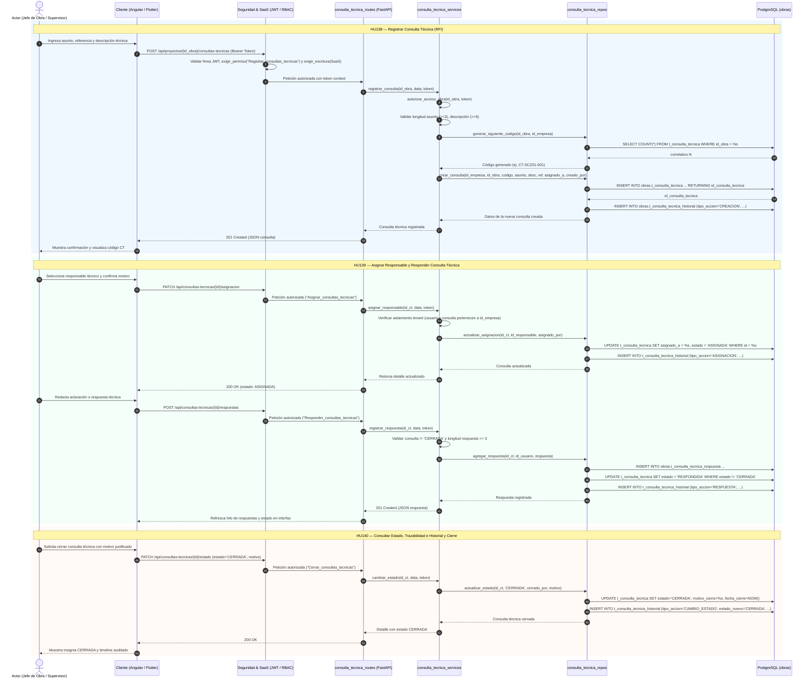
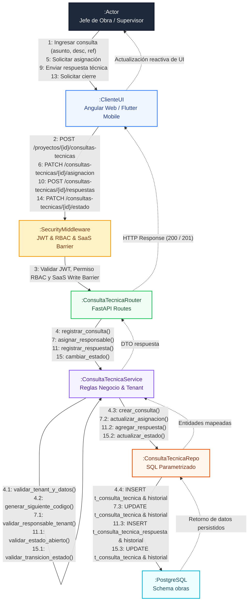

# Decisión Arquitectónica: CU23 — Gestionar consultas técnicas de obra (RFI)

**Fecha:** 2026-10-26  
**Autor:** Antigravity Pairing Assistant  
**Caso de Uso:** CU23 — Gestionar consultas técnicas de obra  
**Historias de Usuario:** HU138, HU139, HU140  
**Alcance:** PostgreSQL (`schema: obras`), FastAPI (Backend), Angular (Web), Flutter (Móvil)  
**Estado:** Aprobado para implementación  

---

## 1. Contexto y Objetivos del Negocio

Durante la ejecución de proyectos de construcción surgen dudas, discrepancias de planos, especificaciones contradictorias o incompatibilidades técnicas en terreno. El CU23 implementa el ciclo de vida auditable de una **Consulta Técnica de Obra** (conocida técnicamente en la industria de la construcción como RFI - *Request for Information*):
* **HU138 (Registrar consulta):** El Jefe de Obra o Supervisor registra la consulta técnica vinculada a un proyecto accesible, con asunto, descripción detallada y referencia técnica (plano, cota, ubicación o documento), asignando un código único correlativo por proyecto (`CT-{codigo_obra}-{correlativo:03d}`). Estado inicial: `ABIERTA`.
* **HU139 (Asignar y responder):** Un usuario autorizado asigna la consulta a un responsable idóneo (especialista, calculista, supervisor o jefe de obra de la misma empresa), transitando a `ASIGNADA`. El responsable o actor autorizado registra respuestas técnicas formales, transitando a `RESPONDIDA`. Tras la resolución satisfactoria, un rol autorizado efectúa el cierre definitivo a `CERRADA`.
* **HU140 (Consultar e historial):** Visualización del listado paginado con filtros por estado, responsable y búsqueda por texto, junto a la vista de detalle con el hilo cronológico de respuestas y la bitácora/timeline inmutable de eventos.

### Diferenciación con otros casos de uso
* **No duplica el CU13 (Órdenes de Trabajo):** La asignación de una consulta técnica define quién debe brindar la aclaración técnica o de ingeniería, no la distribución de cuadrillas ni tareas operativas de obra.
* **No implementa CU41 (Sincronización Offline):** Opera en línea contra la API FastAPI existente tanto en web como en móvil.

---

## 2. Nomenclatura y Persistencia en PostgreSQL (`schema: obras`)

Siguiendo las convenciones existentes de OBRATEC (`t_obra`, `t_incidencia`, `t_orden_trabajo`), las tablas emplean nombres descriptivos en español:

1. **`t_consulta_tecnica` (Registro principal):**
   * `id_consulta_tecnica SERIAL PRIMARY KEY`
   * `id_empresa INTEGER NOT NULL REFERENCES obras.t_empresa(id_empresa) ON DELETE CASCADE`
   * `id_obra INTEGER NOT NULL REFERENCES obras.t_obra(id_obra) ON DELETE CASCADE`
   * `codigo VARCHAR(50) NOT NULL` (Secuencial único por obra: `CT-{codigo_obra}-{correlativo:03d}`)
   * `asunto VARCHAR(200) NOT NULL`
   * `descripcion TEXT NOT NULL`
   * `referencia_tecnica VARCHAR(255)` (opcional: referencia a plano, detalle estructural o ubicación)
   * `estado VARCHAR(30) NOT NULL DEFAULT 'ABIERTA'` (CHECK: `'ABIERTA'`, `'ASIGNADA'`, `'RESPONDIDA'`, `'CERRADA'`)
   * `creado_por INTEGER NOT NULL REFERENCES obras.t_usuario(id_usuario)`
   * `asignado_a INTEGER REFERENCES obras.t_usuario(id_usuario)`
   * `fecha_asignacion TIMESTAMPTZ`
   * `asignado_por INTEGER REFERENCES obras.t_usuario(id_usuario)`
   * `fecha_cierre TIMESTAMPTZ`
   * `cerrado_por INTEGER REFERENCES obras.t_usuario(id_usuario)`
   * `motivo_cierre TEXT`
   * `created_at TIMESTAMPTZ DEFAULT CURRENT_TIMESTAMP`
   * `updated_at TIMESTAMPTZ DEFAULT CURRENT_TIMESTAMP`
   * **Restricciones:** `CONSTRAINT uq_consulta_tecnica_codigo UNIQUE (id_empresa, id_obra, codigo)`
   * **Índices:** `(id_empresa, id_obra, estado)` para búsquedas de alto rendimiento.

2. **`t_consulta_tecnica_respuesta` (Respuestas y aclaraciones técnicas):**
   * `id_consulta_tecnica_respuesta SERIAL PRIMARY KEY`
   * `id_consulta_tecnica INTEGER NOT NULL REFERENCES obras.t_consulta_tecnica(id_consulta_tecnica) ON DELETE CASCADE`
   * `autor_id INTEGER NOT NULL REFERENCES obras.t_usuario(id_usuario)`
   * `contenido TEXT NOT NULL`
   * `created_at TIMESTAMPTZ DEFAULT CURRENT_TIMESTAMP`

3. **`t_consulta_tecnica_historial` (Línea de tiempo y auditoría de eventos):**
   * `id_historial SERIAL PRIMARY KEY`
   * `id_consulta_tecnica INTEGER NOT NULL REFERENCES obras.t_consulta_tecnica(id_consulta_tecnica) ON DELETE CASCADE`
   * `actor_id INTEGER NOT NULL REFERENCES obras.t_usuario(id_usuario)`
   * `tipo_evento VARCHAR(50) NOT NULL` (`CREACION`, `ASIGNACION`, `REASIGNACION`, `RESPUESTA`, `CIERRE`, `REAPERTURA`)
   * `estado_anterior VARCHAR(30)`
   * `estado_nuevo VARCHAR(30)`
   * `detalle TEXT`
   * `created_at TIMESTAMPTZ DEFAULT CURRENT_TIMESTAMP`

---

## 3. Modelo SaaS y Aislamiento Multitenant

1. **Barrera de Suscripción (`suscripcion_policy.py` & `planes_catalog.py`):**
   * Las rutas del CU23 (`/api/proyectos/{id_obra}/consultas-tecnicas` y `/api/consultas-tecnicas/...`) quedan registradas en `planes_catalog.modulo_ruta()` asociadas al módulo base `'obras'`.
   * Toda petición de escritura (POST, PATCH) valida `exigir_escritura(id_empresa)`. Si la empresa está en estado `solo_lectura` (por suscripción vencida o fuera de gracia), el backend rechaza la mutación con `HTTP 403 SUSCRIPCION_SOLO_LECTURA`.
   * Los métodos `GET` permanecen accesibles para lectura histórica y auditoría legal/técnica de la obra.

2. **Aislamiento Multiempresa Estricto:**
   * El `id_empresa` se deriva forzosamente del token JWT verificado (`token.get('id_empresa')`), distinguiendo a `ADMINISTRADOR` (Rol 1 global) de `ADMINISTRADOR_EMPRESA` (Rol 3 tenant).
   * Al crear, listar o modificar consultas, se verifica la relación `t_obra.id_empresa == token_empresa`.
   * Al asignar un responsable, se valida que `t_usuario.id_empresa == token_empresa` y que el usuario se encuentre en estado `ACTIVO`.

3. **RBAC Oficial y Permisos:**
   * Se registran en `t_permiso` vinculados a `id_modulo = 3` (`Modulo_obras`):
     * `Visualizar_consultas_tecnicas` (Roles 1, 3, 4, 9)
     * `Registrar_consultas_tecnicas` (Roles 1, 3, 4, 9)
     * `Asignar_consultas_tecnicas` (Roles 1, 3, 4)
     * `Responder_consultas_tecnicas` (Roles 1, 3, 4, 9)
     * `Cerrar_consultas_tecnicas` (Roles 1, 3, 4)

---

## 4. Contratos de la API REST (`FastAPI`)

| Método | Endpoint | Permiso requerido | Descripción |
|---|---|---|---|
| `GET` | `/api/proyectos/{id_obra}/consultas-tecnicas` | `Visualizar_consultas_tecnicas` | Listado paginado con filtros (`estado`, `id_responsable`, `busqueda`) |
| `POST` | `/api/proyectos/{id_obra}/consultas-tecnicas` | `Registrar_consultas_tecnicas` | Registro de nueva consulta técnica (estado `ABIERTA`) |
| `GET` | `/api/consultas-tecnicas/{id_consulta_tecnica}` | `Visualizar_consultas_tecnicas` | Detalle completo de la consulta, respuestas e historial |
| `PATCH` | `/api/consultas-tecnicas/{id_consulta_tecnica}/asignacion` | `Asignar_consultas_tecnicas` | Asignación o reasignación de responsable técnico |
| `POST` | `/api/consultas-tecnicas/{id_consulta_tecnica}/respuestas` | `Responder_consultas_tecnicas` | Registro de respuesta técnica y transición a `RESPONDIDA` |
| `PATCH` | `/api/consultas-tecnicas/{id_consulta_tecnica}/estado` | `Cerrar_consultas_tecnicas` | Cierre formal (`CERRADA`) con motivo justificado |
| `GET` | `/api/consultas-tecnicas/{id_consulta_tecnica}/historial` | `Visualizar_consultas_tecnicas` | Trazabilidad de eventos de la consulta |

---

## 5. Diseño en Clientes Web (Angular) y Móvil (Flutter)

* **Web (Angular 21):**
  * `ConsultaTecnicaService`: Cliente HTTP tipado con manejo de errores y estados de red.
  * `ProyectoConsultasTecnicasComponent`: Vista integrada al Hub de Obras (`/proyectos/:id/consultas-tecnicas` o dentro de [proyecto-detalle.html](file:///d:/Locked%20Files%20--EY/Projectos/Proyecto_Si2/frontend/src/app/pages/proyectos/detalle/proyecto-detalle.html)).
  * Tarjetas/tabla con badges de estado, buscador dinámico y modal de alta.
  * Drawer/Modal de detalle con hilo conversacional técnico y timeline de cambios.
* **Móvil (Flutter):**
  * `ConsultaTecnicaService`: Consumo mediante `ApiClient`.
  * `ConsultasTecnicasObraScreen`: Navegación desde `ProyectoDetalleScreen`.
  * Interfaz adaptada a dispositivos móviles con listado de tarjetas, estados y diálogos para registro y respuesta.

---

## 6. Plan de Validación y Pruebas

1. **Migración SQL:** Verificación en base de datos de constraints, tipos, secuencias e integridad referencial.
2. **Backend:** Pruebas automatizadas en `backend/tests/test_consulta_tecnica.py`:
   * Creación válida y validación de campos vacíos.
   * Aislamiento multitenant (rechazo cruzado entre empresas).
   * Asignación a usuario ajeno a la empresa (debe fallar).
   * Ciclo de vida: `ABIERTA` $\rightarrow$ `ASIGNADA` $\rightarrow$ `RESPONDIDA` $\rightarrow$ `CERRADA`.
   * Rechazo de respuestas sobre consultas `CERRADA`.
   * Comprobación de política SaaS de `solo_lectura`.
3. **Frontend:** Verificación de navegación, filtros y presentación reactiva.

---

## 7. Resultados de Implementación y Validación

* **Migración SQL:** Aplicada satisfactoriamente en PostgreSQL (`147.15.29.190:5433/obras`). Tablas `t_consulta_tecnica`, `t_consulta_tecnica_respuesta`, `t_consulta_tecnica_historial` y permisos 72-76 vinculados a roles 1, 3, 4 y 9.
* **Backend FastAPI:**
  * Router `consulta_tecnica_routes.py` montado bajo `/api`.
  * Catálogo SaaS `planes_catalog.py` mapeado para módulo `obras`.
  * Suite `tests/test_consulta_tecnica.py` ejecutada: 10 pruebas pasadas exitosamente (10/10 OK en 0.002s).
* **Frontend Angular:**
  * Componente `ConsultasTecnicasComponent` (`consultas-tecnicas.ts`, `.html`, `.css`) y `ConsultaTecnicaService`.
  * Rutas registradas en `app.routes.ts` (`/consultas-tecnicas` y `/proyectos/:id/consultas-tecnicas`).
  * Integración en Hub de Obras `proyecto-detalle.html` y menú `navegacion.ts`.
  * Verificación `npx tsc --noEmit`: 0 errores.
* **Móvil Flutter:**
  * `ConsultaTecnicaService`, `ConsultasTecnicasScreen` y `ConsultaTecnicaDetalleScreen`.
  * Integración en `home_screen.dart` y `proyecto_detalle_screen.dart`.
  * Verificación `dart analyze`: 0 errores y 0 warnings.

---

## 8. Diagramas de Arquitectura

### 8.1. Diagrama de Secuencia (Ciclo de Vida Completo CU23)

### 8.2. Diagrama de Comunicación (Colaboración UML)

### 8.3. Diagramas Vectoriales SVG (Estándar UML 2.5+ y BCE)

Para visualización directa en navegadores o herramientas gráficas:
- **Diagrama de Comunicación (BCE):** [docs/diagramas/diagrama_comunicacion_cu23.svg](../diagramas/diagrama_comunicacion_cu23.svg)
- **Diagrama de Secuencia (UML 2.5+):** [docs/diagramas/diagrama_secuencia_cu23.svg](../diagramas/diagrama_secuencia_cu23.svg)

