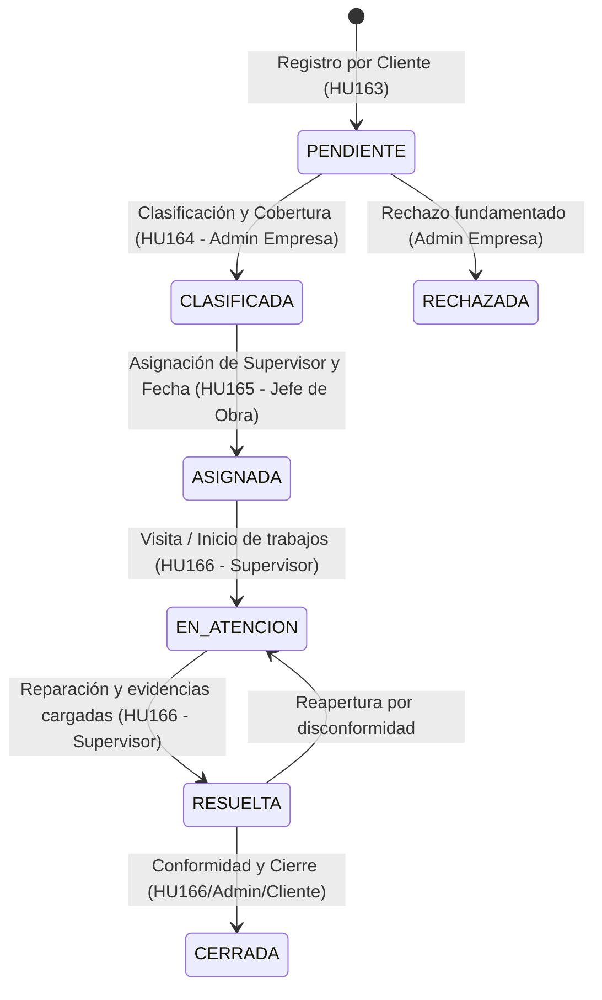

# Decisión Arquitectónica y Diseño: CU33 - Gestión de Garantías y Servicio Posventa (HU161 a HU168)

**Fecha:** 2026-11-23 (America/La_Paz)  
**Autor:** Hassan Clemente  
**Alcance:** Backend (FastAPI), Base de Datos (PostgreSQL), Frontend Web (Angular), Móvil (Flutter).  
**Casos de uso e Historias cubiertas:** CU33 (`HU161`, `HU162`, `HU163`, `HU164`, `HU165`, `HU166`, `HU167`, `HU168`).

---

## 1. Contexto y Problema

El sistema OBRATEC cuenta con módulos comerciales para prospección CRM (CU21) y comercialización de unidades inmobiliarias (CU31 / HU143-HU146), donde las unidades pasan por estados de venta y entrega (`t_crm_cliente_unidad` con estados `RESERVADO`, `VENDIDO`, `ENTREGADO`). 

Sin embargo, tras la entrega al cliente, no existía un mecanismo para:
1. Registrar formalmente las pólizas o garantías contractuales emitidas por la constructora (tipo de cobertura, vigencias y condiciones).
2. Permitir al cliente consultar sus coberturas ni levantar reportes de defectos posventa con evidencia fotográfica.
3. Clasificar reclamos (triage) para validar si están amparados por una garantía vigente.
4. Asignar responsables de obra (Jefe de Obra -> Supervisor/Técnico) para inspección y reparación.
5. Registrar bitácoras técnicas de visitas, insumos utilizados y evidencias de resolución.
6. Dar seguimiento en tiempo real al ticket hasta el cierre formal.
7. Disponer de un historial consolidado y trazable para auditoría de calidad de la constructora.

---

## 2. Actores y Matriz de Responsabilidades

| Actor | Historias | Responsabilidades en el CU33 |
|---|---|---|
| `ADMINISTRADOR_EMPRESA` / `ADMINISTRADOR` | **HU161, HU164, HU168** | Emite garantías para unidades comercializadas, clasifica reclamos entrantes (triage y chequeo de garantía) y consulta métricas/historial consolidado. |
| `CLIENTE` | **HU162, HU163, HU167** | Consulta garantías de sus unidades, reporta tickets de posventa con fotos y consulta la línea de tiempo de atención. |
| `JEFE_DE_OBRA` (`JEFE DE OBRA`) | **HU165** | Recibe solicitudes clasificadas de su obra, asigna un Supervisor técnico, define fecha estimada de visita e instrucciones. |
| `SUPERVISOR` | **HU166** | Ejecuta inspecciones/reparaciones en campo, registra bitácoras de visita, materiales utilizados y fotos de cierre técnico. |

---

## 3. Modelo Relacional Propuesto (PostgreSQL - Esquema `obras`)

### 3.1. `obras.t_unidad_garantia`
Registra los compromisos de garantía formalizados sobre unidades comercializadas:
* `id_garantia SERIAL PRIMARY KEY`
* `id_empresa INT NOT NULL REFERENCES obras.t_empresa(id_empresa)` (Aislamiento multi-tenant)
* `id_unidad INT NOT NULL REFERENCES obras.t_unidad_construccion(id_unidad) ON DELETE CASCADE`
* `id_cliente INT NOT NULL REFERENCES obras.t_crm_cliente(id_cliente) ON DELETE CASCADE`
* `tipo_garantia VARCHAR(60) NOT NULL` (e.g. `ESTRUCTURAL`, `ACABADOS`, `INSTALACIONES_HIDROSANITARIAS`, `INSTALACIONES_ELECTRICAS`, `IMPERMEABILIZACION`, `GENERAL`)
* `descripcion_cobertura TEXT NOT NULL`
* `condiciones TEXT NULL`
* `fecha_inicio DATE NOT NULL`
* `fecha_fin DATE NOT NULL`
* `estado VARCHAR(20) NOT NULL DEFAULT 'VIGENTE'` (`VIGENTE`, `VENCIDA`, `ANULADA`)
* `id_usuario_registro INT REFERENCES obras.t_usuario(id_usuario) ON DELETE SET NULL`
* `created_at TIMESTAMPTZ DEFAULT CURRENT_TIMESTAMP`
* `updated_at TIMESTAMPTZ DEFAULT CURRENT_TIMESTAMP`
* Restricciones: `CHECK (fecha_fin >= fecha_inicio)`, `CHECK (estado IN ('VIGENTE', 'VENCIDA', 'ANULADA'))`.

### 3.2. `obras.t_posventa_solicitud`
Entidad principal del ticket de servicio y reclamo:
* `id_solicitud SERIAL PRIMARY KEY`
* `codigo_ticket VARCHAR(32) NOT NULL UNIQUE` (Formato determinista `PV-YYYYMMDD-XXXXXX`)
* `id_empresa INT NOT NULL REFERENCES obras.t_empresa(id_empresa)`
* `id_unidad INT NOT NULL REFERENCES obras.t_unidad_construccion(id_unidad)`
* `id_cliente INT NOT NULL REFERENCES obras.t_crm_cliente(id_cliente)`
* `id_garantia INT REFERENCES obras.t_unidad_garantia(id_garantia) ON DELETE SET NULL`
* `aplica_garantia BOOLEAN NULL`
* `titulo VARCHAR(200) NOT NULL`
* `descripcion_defecto TEXT NOT NULL`
* `categoria VARCHAR(50) NULL` (`PLOMERIA`, `ELECTRICIDAD`, `ACABADOS`, `ESTRUCTURA`, `CERRAJERIA`, `HUMEDAD`, `OTRO`)
* `prioridad VARCHAR(20) NOT NULL DEFAULT 'MEDIA'` (`BAJA`, `MEDIA`, `ALTA`, `URGENTE`)
* `estado VARCHAR(30) NOT NULL DEFAULT 'PENDIENTE'` (`PENDIENTE`, `CLASIFICADA`, `ASIGNADA`, `EN_ATENCION`, `RESUELTA`, `CERRADA`, `RECHAZADA`)
* `id_usuario_registro INT REFERENCES obras.t_usuario(id_usuario) ON DELETE SET NULL`
* `id_usuario_clasifica INT REFERENCES obras.t_usuario(id_usuario) ON DELETE SET NULL`
* `id_usuario_asigna INT REFERENCES obras.t_usuario(id_usuario) ON DELETE SET NULL`
* `id_supervisor_asignado INT REFERENCES obras.t_usuario(id_usuario) ON DELETE SET NULL`
* `fecha_estimada_visita DATE NULL`
* `instrucciones_tecnicas TEXT NULL`
* `observaciones_clasificacion TEXT NULL`
* `fecha_cierre TIMESTAMPTZ NULL`
* `motivo_rechazo_cierre TEXT NULL`
* `created_at TIMESTAMPTZ DEFAULT CURRENT_TIMESTAMP`
* `updated_at TIMESTAMPTZ DEFAULT CURRENT_TIMESTAMP`

### 3.3. `obras.t_posventa_evidencia`
Almacén de evidencias y fotos (reportadas por cliente o de reparación técnica):
* `id_evidencia SERIAL PRIMARY KEY`
* `id_solicitud INT NOT NULL REFERENCES obras.t_posventa_solicitud(id_solicitud) ON DELETE CASCADE`
* `tipo_evidencia VARCHAR(30) NOT NULL` (`CLIENTE_REPORTE`, `SUPERVISOR_REPARACION`, `DOCUMENTO_ADJUNTO`)
* `ruta_archivo VARCHAR(500) NOT NULL`
* `nombre_archivo VARCHAR(255) NOT NULL`
* `tipo_mime VARCHAR(100)`
* `tamano_bytes INT`
* `id_usuario INT REFERENCES obras.t_usuario(id_usuario) ON DELETE SET NULL`
* `created_at TIMESTAMPTZ DEFAULT CURRENT_TIMESTAMP`

### 3.4. `obras.t_posventa_bitacora`
Historial de acciones y auditoría de la atención del ticket:
* `id_bitacora SERIAL PRIMARY KEY`
* `id_solicitud INT NOT NULL REFERENCES obras.t_posventa_solicitud(id_solicitud) ON DELETE CASCADE`
* `id_usuario INT REFERENCES obras.t_usuario(id_usuario) ON DELETE SET NULL`
* `tipo_evento VARCHAR(40) NOT NULL` (`REGISTRO_TICKET`, `CLASIFICACION`, `ASIGNACION_SUPERVISOR`, `VISITA_TECNICA`, `ACCION_CORRECTIVA`, `CAMBIO_ESTADO`, `CIERRE_TECNICO`)
* `estado_anterior VARCHAR(30)`
* `estado_nuevo VARCHAR(30)`
* `detalle_acciones TEXT NOT NULL`
* `materiales_utilizados TEXT NULL`
* `fecha TIMESTAMPTZ DEFAULT CURRENT_TIMESTAMP`

---

## 4. Máquina de Estados del Ticket de Posventa

---

## 5. Capas Backend (FastAPI)

1. `backend/database/20261123_cu33_garantias_posventa.sql`: Script DDL idempotente.
2. `backend/app/repos/posventa_repos.py`:
   - Funciones SQL parametrizadas garantizando siempre `WHERE s.id_empresa = %s`.
   - Vínculo a `t_crm_cliente` para garantizar que un cliente solo acceda a unidades y tickets propios.
   - Vínculo a supervisores asignados y jefes de obra de la constructora.
3. `backend/app/services/posventa_services.py`:
   - Validaciones de pertenencia de tenant antes de cualquier lectura/escritura.
   - Generación atómica y segura del código único de ticket.
   - Reglas de transición de estados y registro automático en bitácora.
   - Validación de vigencia de garantías (`CURRENT_DATE BETWEEN fecha_inicio AND fecha_fin`).
4. `backend/app/routes/posventa_routes.py`:
   - Endpoints `/api/posventa/garantias` (CRUD y consulta por unidad/cliente).
   - Endpoints `/api/posventa/solicitudes` (Creación, clasificación, asignación, bitácoras, evidencias y cierre).
   - Endpoints `/api/posventa/historial` (Auditoría consolidada y métricas de resolución).

---

## 6. Frontend Angular y Móvil Flutter

* **Angular (`/posventa`):**
  - Bandeja para Administrador de Empresa: Emisión de garantías sobre unidades vendidas, clasificación de solicitudes entrantes, reasignación y panel de historial integral (HU161, HU164, HU168).
  - Bandeja para Jefe de Obra: Tablero de solicitudes clasificadas listas para asignación de supervisor y programación de visita (HU165).
* **Móvil Flutter:**
  - Módulo para Cliente: Consulta de garantías activas (HU162), generación de solicitudes con cámara/fotos (HU163) y timeline en vivo del reclamo (HU167).
  - Módulo para Supervisor: Lista de atenciones a su cargo, registro de bitácora en terreno, insumos usados y fotos de reparación finalizada (HU166).

---

## 7. Plan de Validación y Resultados Reales

1. **Pruebas Unitarias Backend (`backend/tests/test_cu33_posventa.py`):**
   - Ejecutadas con pytest sobre Python 3.14: **12 de 12 pruebas aprobadas** (100% éxito en 1.58s).
   - Validaciones probadas:
     - HU161: Registro de garantía con validación de fechas (`fecha_fin >= fecha_inicio`) y aislamiento de tenant.
     - HU162: Consulta de garantías por cliente restringida a sus unidades adquiridas.
     - HU163: Registro de solicitud con código único determinista (`PV-YYYYMMDD-XXXX`) y estado inicial `PENDIENTE`.
     - HU164: Clasificación por Administrador_empresa con validación de cobertura de garantías vigentes y rechazo de vencidas.
     - HU165: Asignación por Jefe de Obra de supervisor disponible y fecha estimada de visita (`ASIGNADA`).
     - HU166: Atención técnica por Supervisor con bitácora de visita, materiales utilizados y cierre.
     - HU167: Consulta de seguimiento de ticket con línea de tiempo histórica y eventos.
     - HU168: Métricas consolidadas de auditoría e historial de calidad.
     - Aislamiento multi-tenant: Bloqueo de acceso entre empresas distintas con código 404/403.
   - Sin regresión: Pruebas existentes de comercialización (`test_cu31_comercializacion.py`) y pagos (`test_pagos.py`) aprobadas al 100% (33/33).

2. **Validación Frontend Web (Angular):**
   - `ng build`: Compilación exitosa con **cero errores** (`Application bundle generation complete`, exit code 0).
   - Componente `/posventa` registrado en enrutador y navegación lateral.

3. **Validación Móvil (Flutter):**
   - Servicio `posventa_service.dart` y pantalla `posventa_screen.dart` conectados a la API y vinculados en el menú de acceso rápido de `home_screen.dart`.
